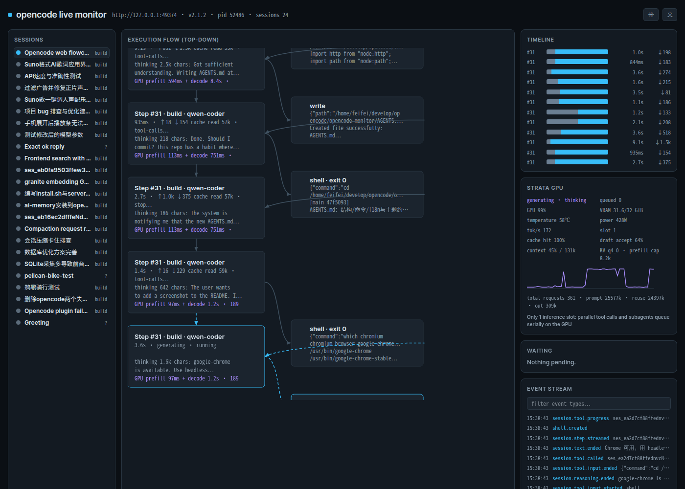

# opencode live monitor

A local web page that draws opencode's execution as a live flow diagram and answers one question directly: **why is it stuck right now**.
**Read-only**: it only reads opencode's API/event stream and Strata metrics; it never calls anything that changes opencode's state.



Regenerate the screenshot (server must be running):

```sh
google-chrome --headless=new --disable-gpu --hide-scrollbars --window-size=1400,1000 \
  --screenshot=docs/screenshot-dark.png http://127.0.0.1:7788/
```

## Starting

Recommended: use the management script (install / build / start / stop / restart / status / test / logs):

```sh
cd /home/feifei/develop/opencode/opencode-monitor
./server.sh install           # npm install + pre-build CSS (first step after a clone)
./server.sh start             # start in background, wait for /api/health; pid recorded in /tmp/opencode/monitor.pid
./server.sh restart           # restart after changing anything under src/ (public/ needs no restart, just reload the browser)
./server.sh status            # process + opencode/Strata connectivity + session count
./server.sh test              # makes sure the server is running, then npm test
./server.sh logs [-f]         # tail /tmp/opencode/monitor.log
open http://127.0.0.1:7788
```

Or run it directly:

```sh
node src/server.js            # or npm start
```

Tailwind is pre-compiled into `public/tailwind.css`, so the runtime has zero dependencies and works offline. Rebuild only after changing styles:

```sh
npm run build               # styles/input.css → public/tailwind.css
```

## Where the data comes from

- **opencode service**: password read from `~/.config/opencode/service.json`; the port is re-discovered every 3 seconds via `opencode service status` (auto-reconnects when the service restarts on a new port).
- **Event stream**: `GET /api/event` (SSE). Mapped: `session.execution.*`, `session.step.*`, `session.reasoning.*`, `session.tool.input.*` / `called` / `progress` / `success`, `session.compaction.*`, `session.usage.updated`, `session.created/deleted` (subagent tree).
- **Fallback polling** (3 s): `/api/session`, `/api/session/active`, `/api/permission/request`, `/api/form`, `/api/shell`.
- **Strata GPU** (2 s): `/metrics`, `/status`, `/slots`, `/api/health` on `http://127.0.0.1:8080`.

## What's on the page

- **Diagnosis card**: one headline + the evidence behind it. Priority: waiting for your approval → waiting for your answer → tool with no progress for a long time → GPU queue (`queued`) → context compaction → provider retry → tool running → generating → idle.
- **Flow diagram**: user input → Step node → tool fan-out (parallel calls side by side, spinner/check/cross + duration + parameters) → next Step. Edges turn yellow and flow while the GPU queue is backed up. Under each Step: Strata `prefill + decode` time, tok/s, KV hit rate (approximated by timestamp).
- **Session tree**: main session and subagent branches indented by `parentID`, colored by status.
- **Timeline**: per-Step duration bars, split into prefill/decode segments.
- **Strata panel**: GPU util, VRAM, temperature, power, tok/s, queued count, KV hit rate, draft accept rate, context usage, util sparkline.
- **Waiting / event stream**: pending permissions, unanswered questions, running shells; filterable event log.
- **Language**: UI defaults to English; a header button toggles Chinese (choice remembered in localStorage).

## Hover details

Hover any node for its full content (parameters, output, thinking text, GPU attribution). You can move the mouse into the tooltip to scroll and select text — live refreshes freeze while you're inside it. Click to pin; click empty space to close. Every content block has a copy button. The current Step (with its tool chips) stays vertically centered in the fixed-height frame, or top-aligned when the block doesn't fit.

## Key fact

Strata has **exactly 1 inference slot** (`/slots`); `pool_workers: 7` is a memory pool, not concurrency slots. So opencode's parallel tool calls and parallel subagents queue serially on the GPU — the "looks stuck" moments are usually this, shown on the page as yellow edges and `queued N`.

## Configuration

Environment variables: `MONITOR_PORT` (default 7788), `MONITOR_HOST` (default 127.0.0.1), `STRATA_URL` (default `http://127.0.0.1:8080`), `OPENCODE_SERVICE_FILE` (default `~/.config/opencode/service.json`).

Binds to 127.0.0.1 only; the service password is used only in server-side request headers and is never sent to the browser (`tests/state-test.mjs` asserts no password appears in snapshots).

## Tests

```sh
npm test                    # state-test (in-memory state machine + diagnosis priorities) + ui-test (jsdom render smoke test, needs the server running)
```
