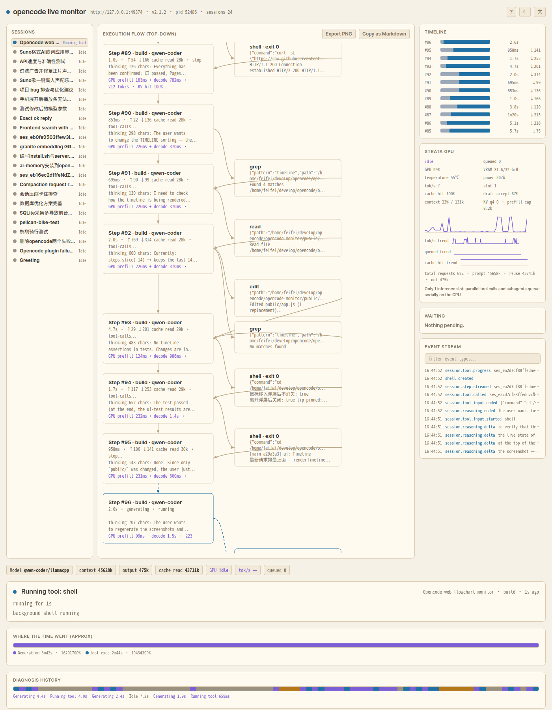

# opencode live monitor

**English** | [中文](README.zh.md)

[](https://github.com/aifeifei798/opencode-monitor/actions/workflows/ci.yml) [](LICENSE)       

A local web page that draws opencode's execution as a live flow diagram and answers one question directly: **why is it stuck right now**.
**Read-only**: it only reads opencode's API/event stream and Strata metrics; it never calls anything that changes opencode's state.

**Live demo (no server needed)**: [https://aifeifei798.github.io/opencode-monitor/?demo=1](https://aifeifei798.github.io/opencode-monitor/?demo=1) plays a scripted session — steps, tool fan-out, approval wait, GPU queue — entirely in the browser.




Regenerate the screenshots (server must be running):

```sh
google-chrome --headless=new --disable-gpu --hide-scrollbars --window-size=1400,1800 \
  --screenshot=docs/screenshot-dark.png http://127.0.0.1:7788/
google-chrome --headless=new --disable-gpu --hide-scrollbars --window-size=1400,1800 \
  --screenshot=docs/screenshot-light.png "http://127.0.0.1:7788/?theme=light"
```

## Starting

Recommended: use the management script (install / build / start / stop / restart / status / test / logs):

```sh
cd /home/feifei/develop/opencode/opencode-monitor
./server.sh install           # npm install + pre-build CSS (first step after a clone)
./server.sh start             # start in background, wait for /api/health; pid recorded in /tmp/opencode/monitor.pid
./server.sh restart           # restart after changing anything under src/ (public/ needs no restart, just reload the browser)
./server.sh status            # process + opencode/Strata connectivity + session count
./server.sh test              # makes sure the server is running, then npm test
./server.sh logs [-f]         # tail /tmp/opencode/monitor.log
open http://127.0.0.1:7788
```

Or run it directly:

```sh
node src/server.js            # or npm start
```

Tailwind is pre-compiled into `public/tailwind.css`, so the runtime has zero dependencies and works offline. Rebuild only after changing styles:

```sh
npm run build               # styles/input.css → public/tailwind.css
```

## Where the data comes from

- **opencode service**: password read from `~/.config/opencode/service.json`; the port is re-discovered every 3 seconds via `opencode service status` (auto-reconnects when the service restarts on a new port).
- **Event stream**: `GET /api/event` (SSE). Mapped: `session.execution.*`, `session.step.*`, `session.reasoning.*`, `session.tool.input.*` / `called` / `progress` / `success`, `session.compaction.*`, `session.usage.updated`, `session.created/deleted` (subagent tree).
- **Fallback polling** (3 s): `/api/session`, `/api/session/active`, `/api/permission/request`, `/api/form`, `/api/shell`.
- **Provider list** (30 s): `/api/provider` — which backend each session actually uses. A provider whose `baseURL` points at `127.0.0.1` is local (Strata); everything else is a remote provider reached through opencode's own API.
- **Strata GPU** (2 s): `/metrics`, `/status`, `/slots`, `/api/health` on `http://127.0.0.1:8080`.

## What's on the page

- **Diagnosis card**: one headline + the evidence behind it. Priority: waiting for your approval → waiting for your answer → tool with no progress for a long time → GPU queue (`queued`) → context compaction → provider retry → tool running → generating → idle.
- **Flow diagram**: user input → Step node → tool fan-out (parallel calls side by side, spinner/check/cross + duration + parameters) → next Step. Edges turn yellow and flow while the GPU queue is backed up. Under each Step: Strata `prefill + decode` time, tok/s, KV hit rate (approximated by timestamp). Export buttons: save the diagram as a 2× PNG, or copy the whole session as Markdown.
- **Session tree**: main session and subagent branches indented by `parentID`, colored by status; each row shows the session's current diagnosis state (waiting for approval / GPU queued / generating / idle …).
- **Timeline**: per-Step duration bars, split into prefill/decode segments.
- **Strata panel**: GPU util, VRAM, temperature, power, tok/s, queued count, KV hit rate, draft accept rate, context usage, util sparkline, plus tok/s / queued / cache-hit trend sparklines from the monitor's own samples.
- **opencode API panel**: when Strata is not connected — or the selected session runs on a remote provider — that same panel switches to the opencode API view: provider name, endpoint, model, last request (step, duration, finish reason), last usage (in / out / cache read), last & total cost, retries, and the in-flight request. The header chips follow suit (Provider / Last request / Cost instead of GPU / tok/s / queued), and the diagnosis no longer blames a GPU queue that this session never used. Chip semantics: `context` is the **last request's** prompt size (input + cache read); session-wide usage is always labeled `total output` / `total cache read`, with millions abbreviated as `M`.
- **Where the time went**: a stacked bar splitting wall-clock time into generation / tool exec / waiting for you (resolved approvals & questions) / other (queue etc.) — approximate, covering the retained step buffer.
- **Diagnosis history**: a colored band showing every diagnosis transition (generating → waiting for approval → GPU queued …) with per-state durations.
- **Waiting / event stream**: pending permissions, unanswered questions, running shells; filterable event log.
- **Language**: UI defaults to English; a header button toggles Chinese (choice remembered in localStorage).

## Hover details

Hover any node for its full content (parameters, output, thinking text, GPU attribution). You can move the mouse into the tooltip to scroll and select text — live refreshes freeze while you're inside it. Click to pin; click empty space to close. Every content block has a copy button. The current Step (with its tool chips) stays vertically centered in the fixed-height frame, or top-aligned when the block doesn't fit.

## Alerts, shortcuts, replay

- **Stuck alerts**: when the diagnosis is waiting for your approval or your answer, the tab title flashes `⚠ …` and a browser notification fires (permission asked once; one alert per session+reason).
- **Keyboard**: `T` theme, `L` language, `1`–`9` select session, `?` toggles the shortcuts/legend overlay, `Esc` closes overlays (ignored while typing in inputs).
- **Replay**: completed sessions show a Replay button — Steps reappear one by one; click again to stop.
- **Themes**: ☀/☾ header toggle (remembered); `?theme=light|dark` URL param forces a theme (used by screenshots); `?demo=1` plays the built-in scripted demo without a server (used by GitHub Pages). Narrow screens (<1024px) stack into a single column with a shorter flow frame.

## Key fact

Strata has **exactly 1 inference slot** (`/slots`); `pool_workers: 7` is a memory pool, not concurrency slots. So opencode's parallel tool calls and parallel subagents queue serially on the GPU — the "looks stuck" moments are usually this, shown on the page as yellow edges and `queued N`.

## Configuration

Environment variables: `MONITOR_PORT` (default 7788), `MONITOR_HOST` (default 127.0.0.1), `STRATA_URL` (default `http://127.0.0.1:8080`), `OPENCODE_SERVICE_FILE` (default `~/.config/opencode/service.json`).

Binds to 127.0.0.1 only; the service password is used only in server-side request headers and is never sent to the browser (`tests/state-test.mjs` asserts no password appears in snapshots).

## Tests

```sh
npm test                    # state-test (in-memory state machine + diagnosis priorities) + ui-test (jsdom render smoke test, needs the server running)
```

GitHub Actions (`.github/workflows/ci.yml`) starts the monitor and runs `npm test` on every push.

## License

Licensed under the Apache License 2.0 — see [LICENSE](LICENSE).
